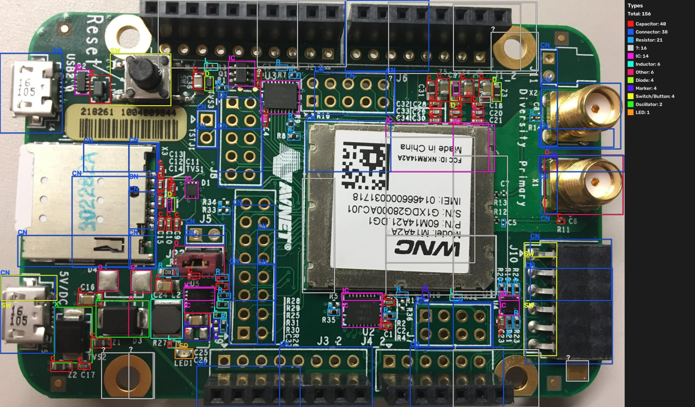
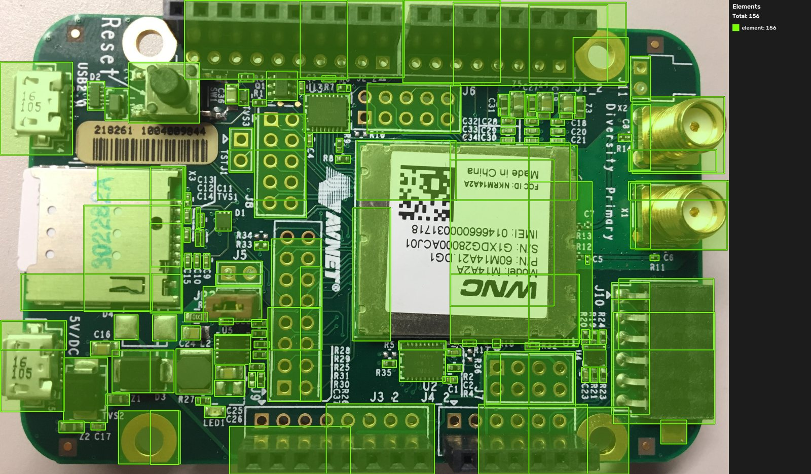
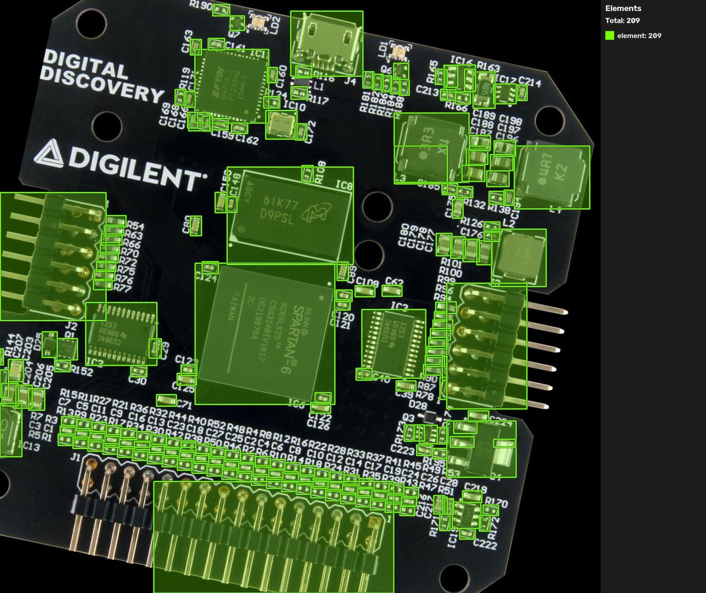
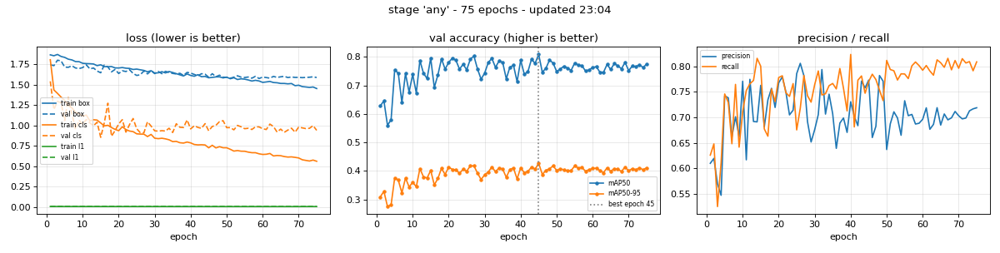
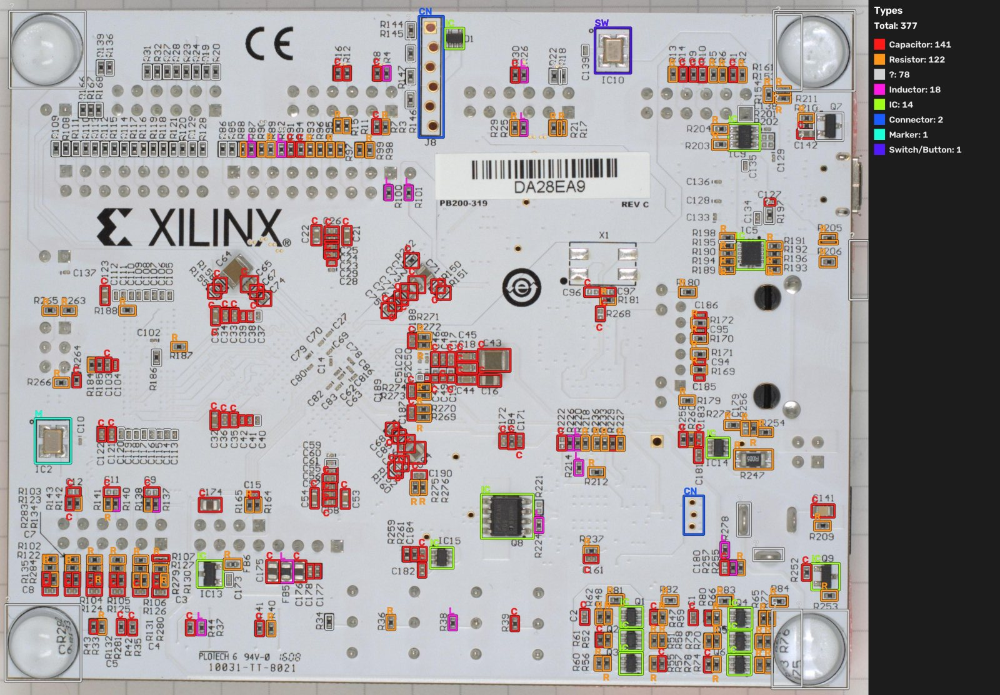
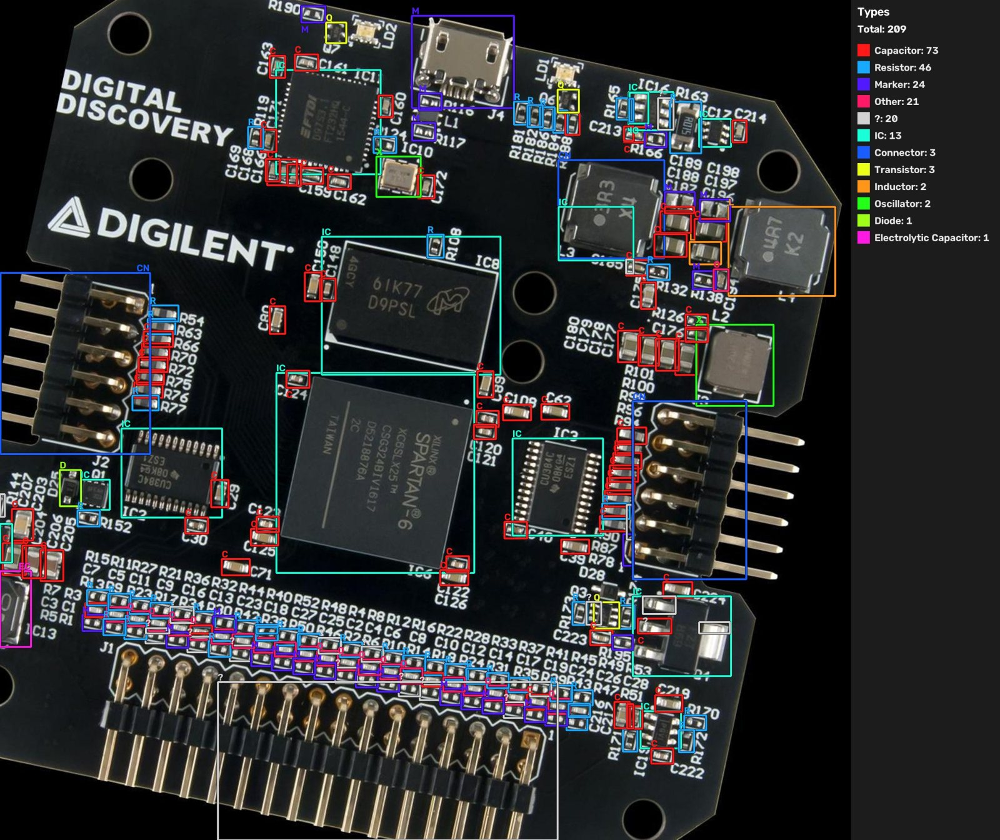
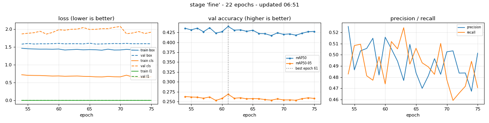
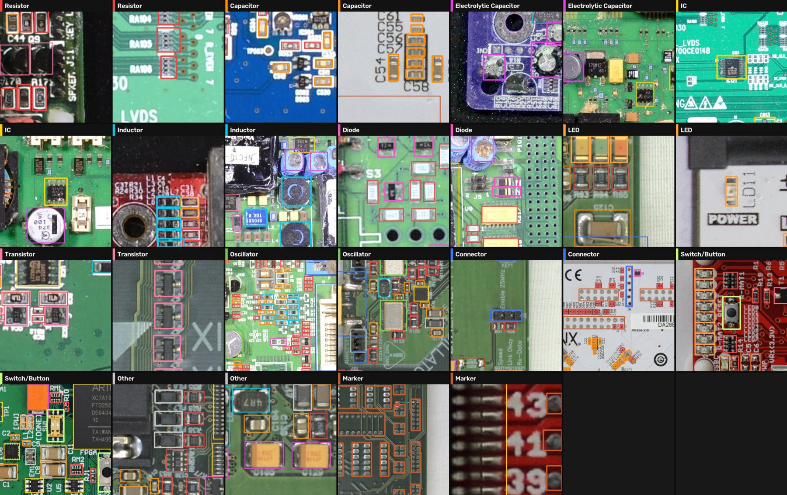
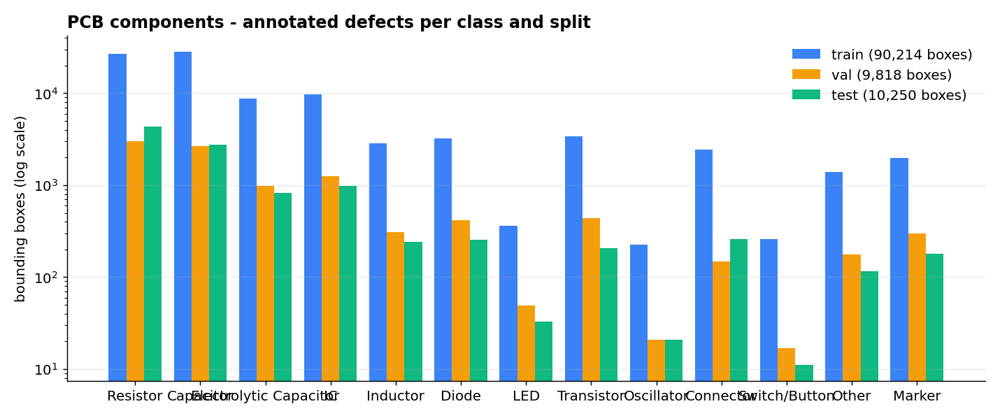

<h1 align="center">PCB Component Detection — YOLO26 (High-Resolution)</h1>

<p align="center">
  <strong>Find and identify every electronic component on a populated circuit board — resistors, capacitors, ICs, connectors, diodes, transistors and more — with a two-stage YOLO26 pipeline on full-resolution, tiled board photos, plus an explainable Random-Forest refiner.</strong>
</p>

<p align="center">
  
  
  
  
  
  
  <a href="https://github.com/ParsaVictor/pcb-component-detection-yolo26/actions"></a>
  
</p>

<p align="center">
  <a href="https://huggingface.co/datasets/ParsaVictor/pcb-component-detection"></a>
  <a href="https://huggingface.co/ParsaVictor/pcb-inspection-suite"></a>
  <a href="https://huggingface.co/ParsaVictor"></a>
</p>

<p align="center">
  
  <br><em>A held-out test board: 156 components located and typed in one pass. Grey <code>?</code> = located, type uncertain (handed to the refiner).</em>
</p>

---

## At a glance

| | |
|---|---|
| **Task** | Detect and classify components on populated PCBs (inventory, BOM check, AOI, reverse engineering) |
| **Pipeline** | ① **`any`** — 1-class *component locator* · ② **`fine`** — 13-class type detector · ③ Random-Forest refiner for uncertain boxes |
| **Model** | Ultralytics **YOLO26s** ×2, 1024 px tiles at **full photo resolution** |
| **Locator accuracy** | val mAP@50 **0.809** / mAP@50-95 0.427 · test mAP@50 **0.732** / 0.376 |
| **Type accuracy** | test mAP@50 **0.432** overall — IC **0.826**, electrolytic capacitor **0.744**, LED 0.652 |
| **Data** | 458 boards (3 sources), 3,618 full-res tiles, **108k annotated components**, board-level split |
| **Weights** | [`weights/`](weights/) — both YOLO26 models + 2 Random-Forest models |
| **History** | v1 = YOLOv8n at 640 px, mAP@50 0.231 → see [`docs/v1-yolov8-baseline.md`](docs/v1-yolov8-baseline.md) |

## What changed since v1

| | v1 (YOLOv8n baseline) | **v2 (this release)** |
|---|---|---|
| Input | 640 px Roboflow export (parts ≈ 6 px) | **original 2000–4900 px photos**, tiled 1024 px / 25 % overlap (median part ≈ 19 px) |
| Taxonomy | 50 noisy classes with duplicates | **13 clean classes** (`configs/class_map.yaml`) |
| Model | 1 detector | **locator + typer + explainable refiner** |
| Locator mAP@50 | — | **0.81 val / 0.73 test** |
| IC mAP@50 | 0.638 | **0.826** |
| Big parts | detected several times across tiles | whole-board pass + tile-border merge |
| Output | one image | `_elements.jpg` (where) + `_types.jpg` (what) + CSV per board |

The key finding: the earlier plateau was caused by the **640 px export, not the model**. Roboflow had down-scaled 4000 px boards so far that a 0402 resistor was 6 pixels wide. The originals were re-downloaded through the Roboflow API, the already-checked labels were mapped back onto them (inverting the rotation / flip / letterbox of the export), and the boards were tiled at native resolution.

## Results

### Stage 1 — where are the components? (`any`)

<p align="center">
  
  
</p>

| Split | Precision | Recall | mAP@50 | mAP@50-95 |
|---|---|---|---|---|
| validation (best epoch 45) | 0.773 | 0.771 | **0.809** | 0.427 |
| test (46 unseen boards) | 0.726 | 0.693 | **0.732** | 0.376 |

<p align="center"></p>

### Stage 2 — what type is each component? (`fine`, 13 classes)

<p align="center">
  
  
</p>

Test set (46 boards never used for training or model selection):

| Class | P | R | mAP@50 |
|---|---|---|---|
| IC | 0.792 | 0.871 | **0.826** |
| Electrolytic Capacitor | 0.903 | 0.618 | **0.744** |
| LED | 0.887 | 0.477 | 0.652 |
| Connector | 0.502 | 0.665 | 0.538 |
| Switch / Button | 0.158 | 0.545 | 0.520 |
| Capacitor | 0.523 | 0.610 | 0.504 |
| Resistor | 0.499 | 0.467 | 0.426 |
| Marker | 0.597 | 0.312 | 0.381 |
| **All 13 classes** | **0.488** | **0.470** | **0.432** (mAP@50-95 0.263) |

<p align="center"></p>

Small passives (resistor vs. ceramic capacitor, both a few pixels of beige/black) remain the hard part — they are *located* reliably by stage 1 but their *type* is often ambiguous at board scale. That is what stage 3 is for.

### Stage 3 — explainable refiner (Random Forest)

| Model | Trained on | Accuracy |
|---|---|---|
| `tree_rf.joblib` | 1,195 isolated component photos, 33 hand-engineered features | **93.0 %** on held-out photos |
| `tree_rf_boards.joblib` | 12,790 component crops from the training boards | 54.8 % on all 2,152 test-board crops · **89.1 % when its confidence ≥ 0.5** (30 % of parts) |

The refiner is only consulted for boxes the YOLO typer leaves as `?`, and only trusted above its confidence threshold. Every decision can be traced through readable features (colour, aspect ratio, edge density, …) — see [pcb-component-classifier](https://github.com/ParsaVictor/pcb-component-classifier).

## Classes

<p align="center">
  
</p>

`Resistor` · `Capacitor` · `Electrolytic Capacitor` · `IC` · `Inductor` · `Diode` · `LED` · `Transistor` · `Oscillator` · `Connector` · `Switch/Button` · `Other` · `Marker` (silkscreen / fiducial marks)

## Dataset

<p align="center">
  
</p>

| | Boards | Tiles (1024 px) | Component boxes |
|---|---|---|---|
| train | 366 | 3,005 | 88,218 |
| val | 46 | 321 | 9,522 |
| test | 46 | 292 | 10,070 |

- 458 boards from 3 sources (own Roboflow project + two public sets), split **by board** so no board appears in two splits.
- Labels were audited (30 duplicate boxes removed), 50 raw class names merged into 13 (`configs/class_map.yaml`).
- Boards whose parts were very large (median > 64 px) are shrunk before tiling (138 of 458) so every tile shows whole components; inference applies the same rule automatically.
- Full report: [`docs/hr_dataset_report.txt`](docs/hr_dataset_report.txt).

## Quick start

```bash
git clone https://github.com/ParsaVictor/pcb-component-detection-yolo26.git
cd pcb-component-detection-yolo26
pip install -r requirements.txt

# both stages: <name>_elements.jpg (where) + <name>_types.jpg (what) + a parts CSV
python hr/infer/predict.py --source my_board.jpg --mode both \
       --any weights/any_best.pt --fine weights/fine_best.pt --out results/my_board
```

Big photos are tiled automatically at the training scale; `--conf` trades recall for precision (default 0.20); `--refine` plugs in any crop classifier for the `?` boxes.

**Testing notebook (no training):** [`hr/notebooks/PCB_Test_Colab.ipynb`](hr/notebooks/PCB_Test_Colab.ipynb) runs all three models on your own boards with sliders for confidence / IoU (raw detections are cached, so re-filtering is instant) and reports speed and per-stage accuracy. Works on GPU or CPU.

## Train it yourself

[`hr/notebooks/PCB_Detector_Colab.ipynb`](hr/notebooks/PCB_Detector_Colab.ipynb) on a free Colab T4 — trains `any` then `fine`, saves to one Google Drive folder, resumes automatically after a disconnect (it re-targets the checkpoint's stored save directory so a new session never restarts from scratch), and also runs on CPU.

```bash
python hr/train/train_yolo26.py --data-root final_dataset_hr --project runs_hr \
       --stages any fine --model yolo26s.pt --imgsz 1024 --epochs 80 --batch 8
```

Rebuilding the high-resolution dataset (needs `ROBOFLOW_API_KEY`):

```bash
python hr/tools/fetch_originals.py list && python hr/tools/fetch_originals.py fetch && python hr/tools/fetch_originals.py build
python hr/tools/build_hr_dataset.py        # tile 1024 / 25 % overlap, board-level split
```

## Repository layout

```
├── weights/              any_best.pt, fine_best.pt (YOLO26s) · tree_rf*.joblib (Random Forest) + reports
├── hr/
│   ├── infer/predict.py         two-stage tiled inference, elements/types images, CSV
│   ├── train/train_yolo26.py    any → fine training with Drive resume
│   ├── tools/                   original-resolution rebuild, tiling, QA; test_nb/ = 3-model fusion engine
│   └── notebooks/               training notebook + test-only notebook
├── src/pcb_detection/    v1 library (dataset validation, duplicate-class merge, tiled NMS) — tested in CI
├── tests/                23 unit tests, no GPU or dataset needed
├── configs/              class_map.yaml (50 → 13 classes), train.yaml
├── docs/                 v1 baseline analysis, HR dataset report
└── assets/, results/     figures
```

## FAQ

**What does this detect?**
Every component on an assembled PCB, in 13 types: resistor, capacitor, electrolytic capacitor, IC, inductor, diode, LED, transistor, oscillator, connector, switch/button, other and marker.

**Why two YOLO models instead of one?**
Finding *where* a component is is far easier than naming it. The 1-class locator reaches mAP@50 0.81 and gives a reliable component count and footprint map; the 13-class model adds the type; uncertain types go to an explainable classifier instead of being guessed.

**Why does resolution matter so much?**
Board photos are 2000–4900 px wide. Down-scaled to 640 px, a 0402 resistor is ~6 px and undetectable. Tiling at native resolution gives the model ~19 px parts.

**Does it find soldering defects?**
No — see the companion [**pcb-solder-defect-detection-yolo26**](https://github.com/ParsaVictor/pcb-solder-defect-detection-yolo26) (assembled boards) and [**pcb-bare-board-defect-detection-yolo26**](https://github.com/ParsaVictor/pcb-bare-board-defect-detection-yolo26) (bare boards).

## Part of a PCB inspection suite

| Repository | Stage | What it does |
|---|---|---|
| [pcb-bare-board-defect-detection-yolo26](https://github.com/ParsaVictor/pcb-bare-board-defect-detection-yolo26) | before assembly | copper / etching defects |
| [pcb-solder-defect-detection-yolo26](https://github.com/ParsaVictor/pcb-solder-defect-detection-yolo26) | after assembly | soldering and placement defects |
| **pcb-component-detection-yolo26** | after assembly | locates and identifies every component |
| [pcb-component-classifier](https://github.com/ParsaVictor/pcb-component-classifier) | per part | explainable Random-Forest classifier |

## Citation

```bibtex
@software{karkooti_2026_pcb_components,
  author = {Karkooti, Mohammad Parsa},
  title  = {PCB Component Detection with YOLO26 on High-Resolution Tiled Boards},
  year   = {2026},
  url    = {https://github.com/ParsaVictor/pcb-component-detection-yolo26}
}
```

## License

MIT — see [LICENSE](LICENSE). Dataset: CC BY 4.0 ([Roboflow Universe](https://universe.roboflow.com/parsa-karkooti/pcb-wik5v-zonih)).

## Author

**Mohammad Parsa Karkooti** — AI Engineer (Computer Vision, Deep Learning)
[GitHub](https://github.com/ParsaVictor) · [LinkedIn](https://www.linkedin.com/in/parsa-karkooti) · [Email](mailto:1.parsa.karkooti@gmail.com)

<sub>Keywords: PCB component detection, electronic component recognition, printed circuit board, YOLO26, object detection, small object detection, tiled inference, SAHI-style tiling, resistor capacitor IC detection, BOM verification, automated optical inspection, reverse engineering electronics.</sub>
