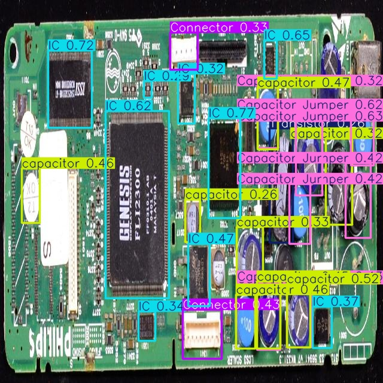
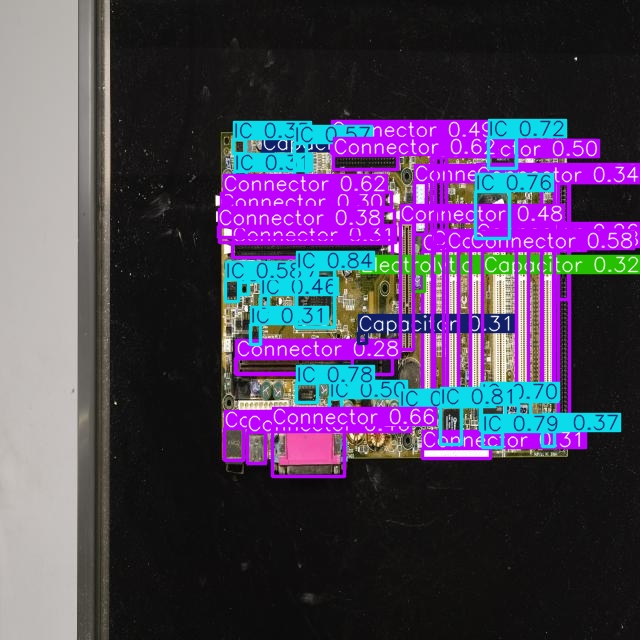
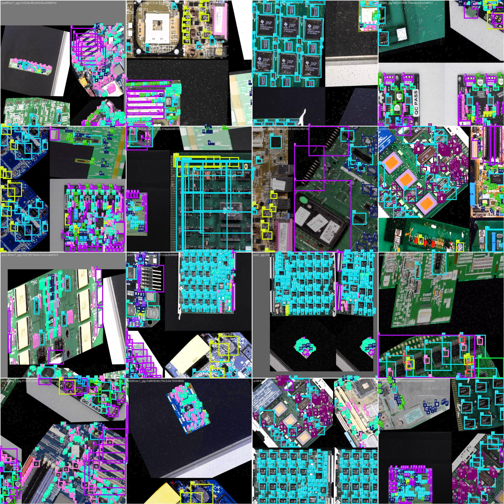
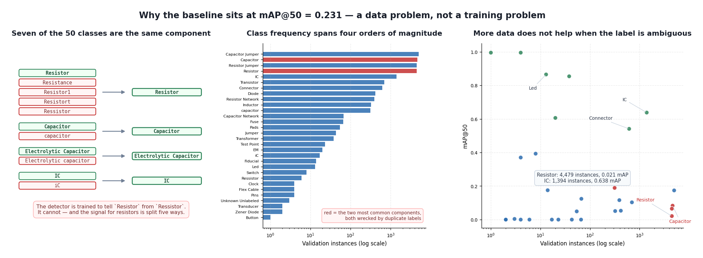
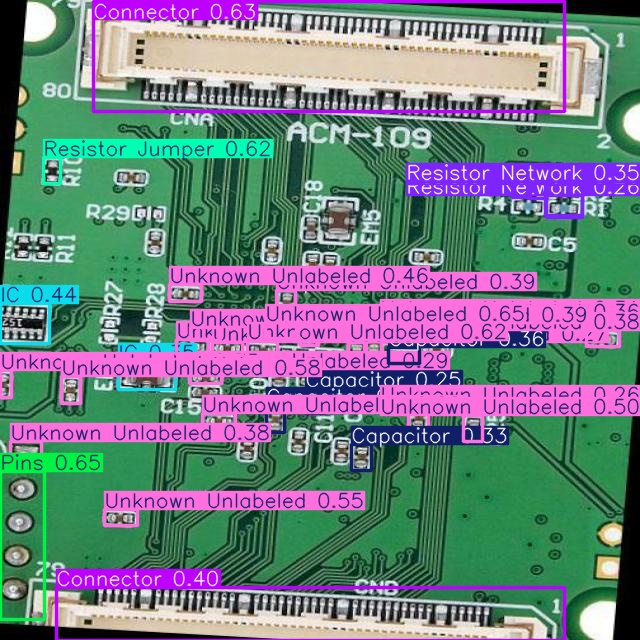
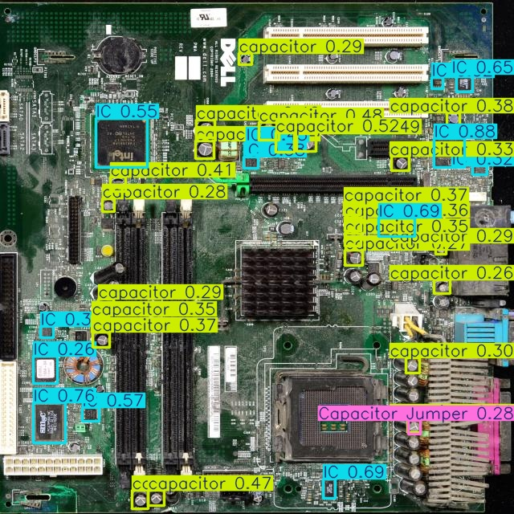
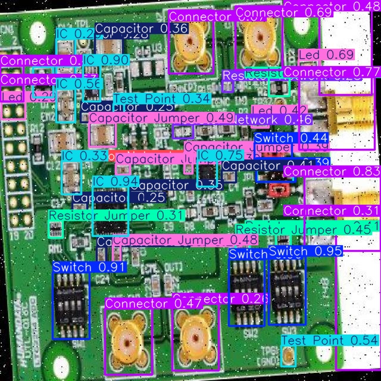

<h1 align="center">PCB Component Detection — YOLOv8</h1>

<p align="center">
  <strong>Locating electronic components on populated circuit boards — a baseline detector, and a clear account of what limits it.</strong>
</p>

<p align="center">
  
  
  
  
  
  <a href="https://universe.roboflow.com/parsa-karkooti/pcb-wik5v-zonih"></a>
  <a href="https://github.com/ParsaVictor/pcb-component-detection-yolov8/actions"></a>
</p>

---

> **Status: baseline.** This is an honest first pass at a hard detection problem — 50 classes, 675,598 annotations, an average of 182 components per board. It reaches **mAP@50 = 0.231**, and the interesting part of this repository is not that number but the [diagnosis of why](dataset-analysis.md) and the tooling built to fix it.

<p align="center">
  
  
  <br><em>Left: ICs, connectors and capacitors found on a consumer board — and note <code>Capacitor</code>, <code>capacitor</code> and <code>Capacitor Jumper</code> all firing on the same region, which is the taxonomy problem below made visible. Right: connectors and ICs on a dense board.</em>
</p>

## The problem

Detecting components on a populated PCB is not the same problem as classifying a component in isolation:

- **Density.** 23,327 instances across 128 validation boards — 182 components per image.
- **Scale.** A board downscaled to 640 px leaves an 0402 passive a few pixels across.
- **Taxonomy.** 50 classes, of which several are the same part under a different spelling.
- **Imbalance.** Class frequency spans four orders of magnitude, from 4,988 instances down to 1.

<p align="center">
  
  <br><em>A single training batch. Every coloured box is one annotated component — this is what 182 components per board looks like, and why small-object detection is the binding constraint here.</em>
</p>

## Baseline results

YOLOv8n, 50 epochs, 640 px, Colab GPU.

| Metric | Value |
|---|---|
| Precision | 0.343 |
| Recall | 0.209 |
| mAP@50 | 0.231 |
| mAP@50-95 | 0.151 |

### Where it works

| Class | Instances | Precision | Recall | mAP@50 |
|---|---|---|---|---|
| Led | 13 | 0.837 | 0.769 | **0.865** |
| IC | 1,394 | 0.433 | 0.760 | **0.638** |
| EM | 20 | 0.830 | 0.245 | 0.606 |
| Connector | 616 | 0.378 | 0.715 | 0.541 |

`IC` is the informative row: well-represented, visually distinct, no duplicate label competing with it — and it reaches 0.638. That is what the setup achieves when the data cooperates.

### Where it fails, and why

| Class | Instances | mAP@50 | Cause |
|---|---|---|---|
| Resistor | 4,479 | 0.021 | split across **5 duplicate labels** |
| Capacitor | 4,640 | 0.083 | duplicate `capacitor` label; objects too small at 640 px |
| Test Point | 23 | 0.000 | a few pixels across at this resolution |
| Fuse | 66 | 0.000 | too few instances, visually ambiguous |

## The main finding: a broken taxonomy

<p align="center">
  
</p>

Seven of the 50 classes are duplicates — the same physical component under a different spelling or letter case:

| Duplicate | Canonical |
|---|---|
| `Resistance`, `Resistor1`, `Resistort`, `Ressistor` | `Resistor` |
| `capacitor` | `Capacitor` |
| `Electrolytic capacitor` | `Electrolytic Capacitor` |
| `iC` | `IC` |

The detector is being trained to *distinguish between* `Resistor` and `Ressistor`. It cannot, because they are the same object — and the training signal for resistors is split five ways. That is why the most common component on any board scores 0.021.

The fix is implemented and tested:

```bash
python scripts/train.py --data PCB-1/data.yaml --merge-duplicates
```

The baseline above is deliberately the *un-merged* result, so the improvement can be measured against it rather than asserted.

Full analysis in [`docs/dataset-analysis.md`](dataset-analysis.md).

## More detections

<p align="center">
  
  
  
</p>

The left board shows a second data problem the analysis picks up: `Unknown Unlabeled` fires across most of the passives, because that class absorbs everything the annotators did not name. It is a label of last resort competing with the real classes.

## Dataset

Published on Roboflow Universe under CC BY 4.0:

**https://universe.roboflow.com/parsa-karkooti/pcb-wik5v-zonih**

| | |
|---|---|
| Boards | 3,170 annotated images |
| Annotations | 675,598 |
| Classes | 50 |
| Size | ~724 MB |
| Label integrity | 0 malformed, 0 out-of-range, 0 out-of-bounds |

The annotations are clean — `validate_labels()` passes on all 675,598. The problems are in the taxonomy and the distribution, not the geometry.

The dataset is fetched rather than committed (724 MB does not belong in a git history). Six sample boards are included in `data/samples/` so inference can be run immediately.

## Installation

```bash
git clone https://github.com/ParsaVictor/pcb-component-detection-yolov8.git
cd pcb-component-detection-yolov8
pip install -r requirements.txt
```

## Usage

**Get the dataset** — a free Roboflow key is needed:

```bash
export ROBOFLOW_API_KEY="your_key"    # https://app.roboflow.com/settings/api
python scripts/download_dataset.py
```

The script downloads the dataset and validates every annotation.

**Train:**

```bash
python scripts/train.py --data PCB-1/data.yaml --epochs 50 --device 0
```

Recommended for a real run rather than reproducing the baseline:

```bash
python scripts/train.py --data PCB-1/data.yaml \
    --model yolov8s.pt --imgsz 1280 --epochs 100 --merge-duplicates
```

**Detect:**

```bash
python scripts/predict.py --weights runs/train/pcb_yolov8/weights/best.pt \
    --source data/samples --save
```

**Tiled inference** for high-resolution boards, where components are small relative to the frame:

```bash
python scripts/predict.py --weights best.pt --source board.jpg --tile
```

Tiling runs the detector on overlapping crops at native resolution and merges the results with class-aware NMS — the standard remedy for small-object detection.

**As a library:**

```python
import sys; sys.path.insert(0, "src")
from pcb_detection import train, evaluate, tile_inference, validate_labels, find_label_files

report = validate_labels(find_label_files("PCB-1"))
print(f"{report['total']} annotations, clean: {report['clean']}")

model, _ = train("PCB-1/data.yaml", epochs=50, imgsz=1280)
print(evaluate(model, "PCB-1/data.yaml"))
```

## Project structure

```
pcb-component-detection-yolov8/
├── src/pcb_detection/
│   ├── dataset.py       # download, validation, duplicate-class merging
│   ├── training.py      # train/evaluate wrappers over Ultralytics
│   └── tiling.py        # tiled inference + class-aware NMS
├── scripts/
│   ├── download_dataset.py   # fetch from Roboflow + validate every label
│   ├── train.py              # fine-tune, optionally merging duplicates
│   ├── predict.py            # inference, whole-image or tiled
│   └── make_analysis_figure.py  # regenerates the analysis figure above
├── notebooks/           # the original training notebook, with outputs
├── tests/               # 23 tests, no dataset or GPU required
├── data/samples/        # 6 boards, for inference without the full download
├── results/             # baseline metrics, analysis figure, sample detections
├── configs/train.yaml
└── docs/dataset-analysis.md
```

## Tests

```bash
pip install -r requirements-dev.txt
pytest tests/ -v
```

23 tests over the class taxonomy, label validation, duplicate merging (including idempotency) and the NMS geometry. They need neither the dataset nor a GPU, so CI runs in seconds.

## Roadmap

Ordered by expected value — see [`docs/dataset-analysis.md`](dataset-analysis.md) for the reasoning:

- [ ] **Merge the duplicate classes** (50 → 43) and re-measure — implemented, not yet run to completion
- [ ] Retrain at `imgsz=1280` so small passives are resolvable at all
- [ ] Group or drop the classes with too few instances to measure
- [ ] Move up to YOLOv8s/m — Nano is a baseline backbone, not a final one
- [ ] Benchmark tiled inference against the whole-image baseline
- [ ] **Combine with the classifier**: use this detector to locate components, then classify each crop with the explainable model

## Related work

[**pcb-component-classifier**](https://github.com/ParsaVictor/pcb-component-classifier) — the classification half of the problem: a Random Forest over hand-engineered features reaching **93.3%** on held-out images, with every prediction traceable to a readable decision path.

The two are designed to be combined: detection provides scale, the classifier provides transparency on each detected crop.

## Licence

MIT — see [LICENSE](../LICENSE). The dataset is CC BY 4.0.

## Author

**Mohammad Parsa Karkooti** — AI Engineer (Computer Vision, Machine Learning, Deep Learning)

[GitHub](https://github.com/ParsaVictor) · [LinkedIn](https://www.linkedin.com/in/parsa-karkooti) · [Email](mailto:1.parsa.karkooti@gmail.com)
